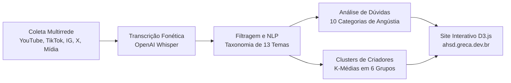

# Radar da Superdotação · AH/SD no Brasil (2021 a 2026)

> **Projeto de dados sobre Mensa, altas habilidades e superdotação no Brasil.**  
> Publicado em produção em: [https://ahsd.greca.dev.br](https://ahsd.greca.dev.br)

---

## 📌 Visão Geral

O Brasil viveu uma explosão de visibilidade sobre altas habilidades e superdotação (AH/SD) nos últimos cinco anos. Entre 2021 e 2026, as manchetes sobre o tema cresceram **675%**, e o volume de conteúdos nas principais redes de vídeo saltou mais de **400%**. 

No entanto, há um descompasso evidente entre o que a imprensa noticia e o que o público espontaneamente expressa: enquanto a mídia tradicional foca em crianças prodígio e testes de QI como espetáculo, os comentários e buscas de pessoas reais revelam uma busca urgente por **diagnóstico tardio na vida adulta**, sofrimento psíquico, comorbidades (dupla excepcionalidade com TDAH e Autismo) e a necessidade de acolhimento entre iguais.

Este repositório reúne o pipeline de coleta, transcrição fonética, classificação semântica com inteligência artificial, agrupamento em clusters e os dados que alimentam a plataforma web interativa.

---

## 📊 A Base em Números (2021 a 2026)

A coleta abrangeu dados de 2021 até 27 de outubro de 2026:

| Dimensão | Volume | Detalhamento |
| :--- | :--- | :--- |
| **Comentários de Redes** | **98.861** | YouTube (80.809), Instagram (16.795), X (1.257 respostas) |
| **Vídeos e Áudios Analisados** | **870** | YouTube (353 vídeos), TikTok (517 vídeos sobre o tema de 1.464 monitorados) |
| **Posts em Redes Sociais** | **708** | Instagram (458 posts no tema de 1.478), X (250 tweets no tema de 427) |
| **Imprensa e Mídia Tradicional** | **1.474** | 1.264 reportagens em portais/Google Notícias e 210 artigos de 15 revistas |
| **Alcance Medido em Views** | **74,3 milhões** | TikTok (39,5 mi), YouTube (30,7 mi), Instagram (3,8 mi), X (360 mil) |
| **Engajamento Registrado** | **4,4 mi curtidas** e **192 mil comentários** | Engajamento massivo em cortes de podcasts, relatos pessoais e clínicas |
| **Audiência Potencial Instagram** | **29,4 milhões** | Seguidores combinados nos 87 perfis especializados monitorados |

---

## 🔍 Principais Achados

1. **A Explosão do Assunto (+675%):** De 53 manchetes anuais em 2021 para 411 em 2026. A entrada de cortes de podcasts virais popularizou o vocabulário de neurodivergência.
2. **O Abismo Mídia vs. Redes:** Mais de 60% da cobertura da imprensa convencional retratou crianças prodígio entrando na faculdade ou sendo aceitas em sociedades de alto QI. Nas redes sociais, o tema com maior engajamento espontâneo foi a **descoberta na vida adulta** e os desafios socioemocionais.
3. **Mensa e a Necessidade de Iguais:** Os 2% com maior QI no Brasil representam mais de **4,3 milhões de pessoas**. Longe de um elitismo vazio, a procura por entidades e comunidades decorre da necessidade humana e psicológica fundamental de **viver e dialogar entre pares** sem julgamento ou sensação de desajuste.
4. **Dupla Excepcionalidade em Alta:** A sobreposição de AH/SD com TEA (autismo) e TDAH é um dos temas que mais geram dúvidas e relatos de desamparo na busca por profissionais habilitados.

---

## 🛠️ Metodologia e Pipeline de Dados



- **Transcrição de Áudio:** Vídeos de criadores e podcasts foram transcritos com o modelo OpenAI Whisper para análise integral da fala (não apenas legendas ou títulos).
- **Classificação Semântica com IA:** Classificação temática estruturada em 13 eixos semânticos e identificação de dúvidas e angústias do público.
- **Clusters de Criadores:** 6 clusters identificados via algoritmo k-médias (*Clínica e avaliação*, *QI como espetáculo*, *Neurodivergência e podcasts*, *Educação e famílias*, *Descoberta adulta*, *Mensa e mídia*).
- **Ética e Privacidade:** Autores de comentários do público geral foram estritamente anonimizados. Apenas perfis públicos de criadores, imprensa e instituições são citados.

---

## 📁 Estrutura do Projeto

```text
.
├── site_panorama/          # Frontend estático publicado em ahsd.greca.dev.br
│   ├── index.html          # Panorama geral, resumo executivo e 9 capítulos
│   ├── mapa.html           # Mapa de influência (Treemap interativo e Grafo de rede)
│   ├── historia.html       # Linha do tempo interativa ano a ano (2021 a 2026)
│   ├── tabelas.html        # Tabelas dinâmicas completas de dados
│   ├── metodologia.html    # Detalhamento metodológico, funis e limites
│   ├── app.js              # Lógica de renderização de gráficos e tabelas
│   ├── mapa.js             # Implementação D3.js do Treemap e Grafo de força
│   ├── dados.js            # Dataset consolidado e otimizado para a web
│   └── img/                # Capas conceituais e fotos tratadas dos perfis
├── banco de dados/         # Bancos locais SQLite das coletas (ignorado no git)
├── dados/                  # JSONLs intermediários e bases processadas
├── instagram/              # Scripts de scraping e processamento de Instagram
├── tiktok/                 # Scripts de scraping e transcrição de TikTok
├── x/                      # Scripts de coleta de posts e respostas do X
├── noticias/               # Raspadores de portais de notícia e revistas
└── README.md               # Apresentação e documentação do projeto
```

---

## 👤 Sobre o Autor

**Aislan Greca**  
*Cientista de Dados e Pesquisador de Opinião e Mídia*  
- Site Pessoal: [greca.dev.br](https://greca.dev.br)  
- LinkedIn: [linkedin.com/in/aislangreca](https://www.linkedin.com/in/aislangreca)  
- Fundador e Coordenador da comunidade **Talentos Ocultos: Superdotação no Ambiente de Trabalho** no LinkedIn ([Grupo 9505909](https://www.linkedin.com/groups/9505909/)).
- Formado em Ciência de Dados (UNIVESP) e Relações Públicas (UEL), com Mestrado em Gestão e Desenvolvimento com pesquisa em processamento de linguagem natural e psicossociologia aplicada (UNITAU).
- Diagnosticado com Altas Habilidades na idade adulta, uniu o rigor analítico da ciência de dados à sua vivência pessoal para estruturar o mais abrangente raio-x da superdotação no ecossistema digital brasileiro.

---

## ⚖️ Licença

Código sob licença MIT. Os dados coletados provêm de plataformas públicas e reportagens de livre acesso, preservando a anonimização de dados pessoais de terceiros.
